<p align="center">
  
</p>

<p align="center">
  
</p>

### ✦ 自己紹介 · about

I build things end to end: from the database schema to the button your customer actually taps.
Mostly **Python** and **Go**, mostly **Telegram bots & Mini Apps**, always shipped in **Docker** with CI/CD and a real server at the end of the pipeline.

Right now I'm building **enroute** - cross-border delivery where you paste a Poizon link into a Mini App and the parcel shows up at your door.

```yaml
ships:     bots · mini apps · APIs - from first commit to prod
stack:     python · go · postgres · docker · github actions
now:       enroute - cross-border delivery as a Telegram Mini App
learning:  go internals · distributed systems · k8s
mode:      night owl 🌙
```

<p>
  <a href="https://t.me/saikokiro"></a>
</p>

<p align="center">
  
</p>

<p align="center"></p>

### ✦ 道具 · stack

<p>
  
</p>
<p>
  
</p>

<p align="center"></p>

### ✦ 作品 · projects

| | Project | What it is | Stack |
|---|---|---|---|
| 🚚 | **enroute** | Cross-border delivery service: Telegram Mini App for ordering from US / China stores, staged payments, tracking, bot notifications | Go · PostgreSQL · vanilla JS · Docker · GitHub Actions → GHCR |
| 🏋️ | [**Kachalka**](https://github.com/saikoxdd/kachalka) | Workout tracker for a 3-week strength cycle with auto progression: iOS app with Live Activity on the Dynamic Island, the same UI as a Telegram Mini App and an installable PWA | Swift · SwiftUI · WidgetKit · WKWebView · JS |
| ⌨️ | [**TypeSpeed**](https://github.com/saikoxdd/typespeed) | Native macOS typing-speed test in the spirit of Monkeytype: Russian word pools, profile with stats | Swift · WKWebView · JS |
| 📚 | **Tutoring platform** | Lesson booking, homework exchange, role-based access for tutor and students | FastAPI · PostgreSQL · React · Docker Compose |
| 🏄 | **Surf school bot** | Forecast posts in a channel → private booking of boards and wetsuits by size, admin panel inside the bot | Python · aiogram · PostgreSQL |
| 📦 | [**LogHub bot**](https://github.com/saikoxdd/loghub-bot) | Order tracking for a Russia - China logistics service: price calculator, photo status updates, deep-link tracking, admin panel. Started as my bachelor's thesis, rewritten from scratch | Python · aiogram 3 · async SQLAlchemy · pytest · Docker |

<p align="center"></p>

### ✦ 統計 · stats

<p align="center">
  
</p>

<p align="center">
  
</p>

<p align="center">
  
</p>
